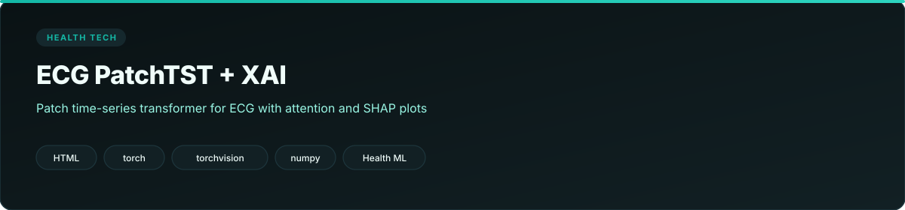
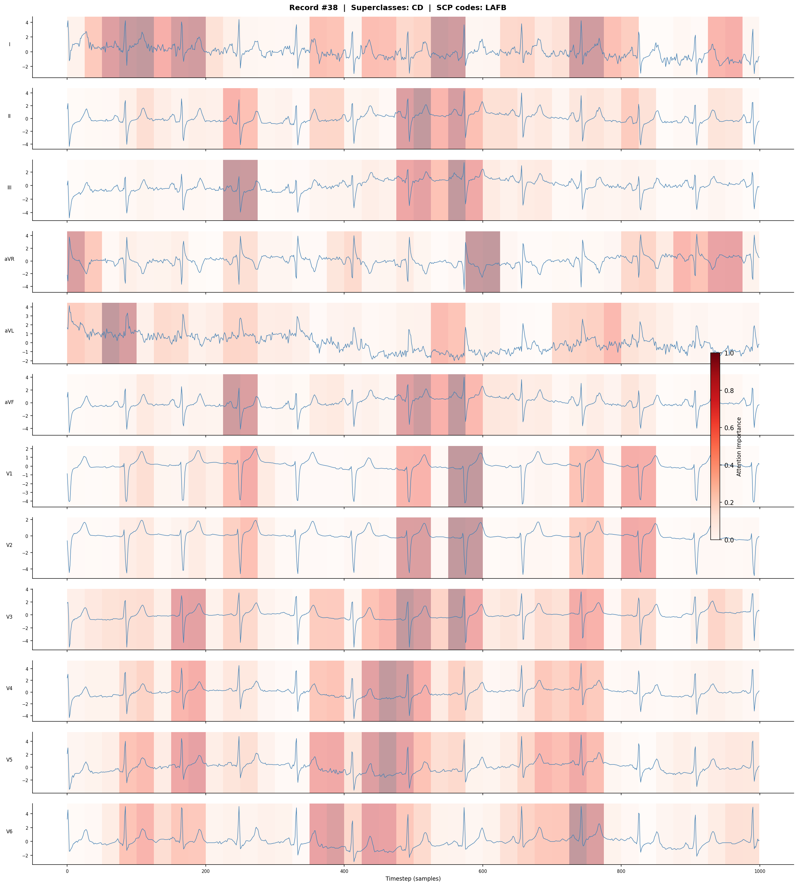
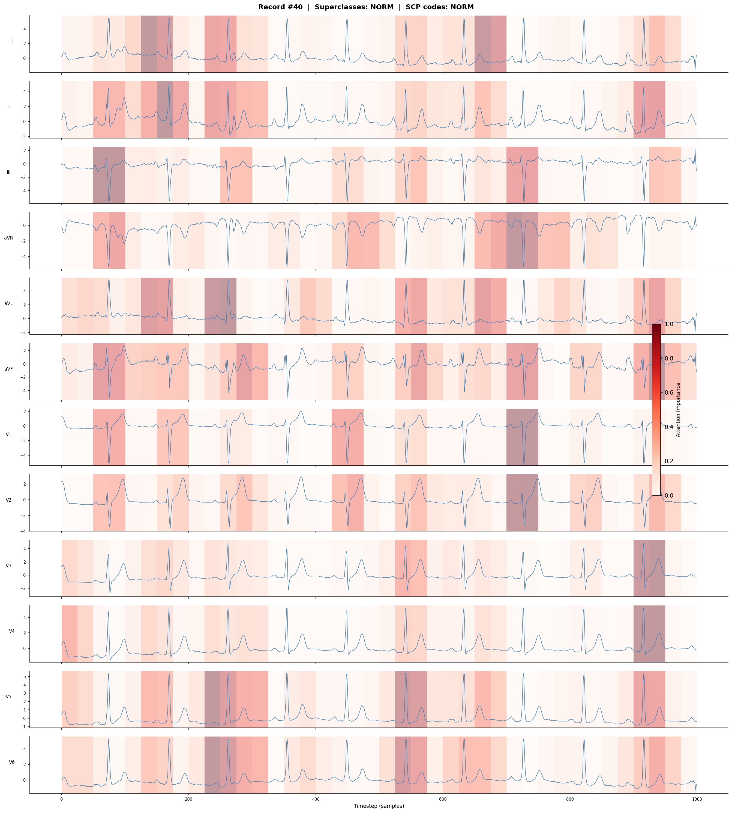
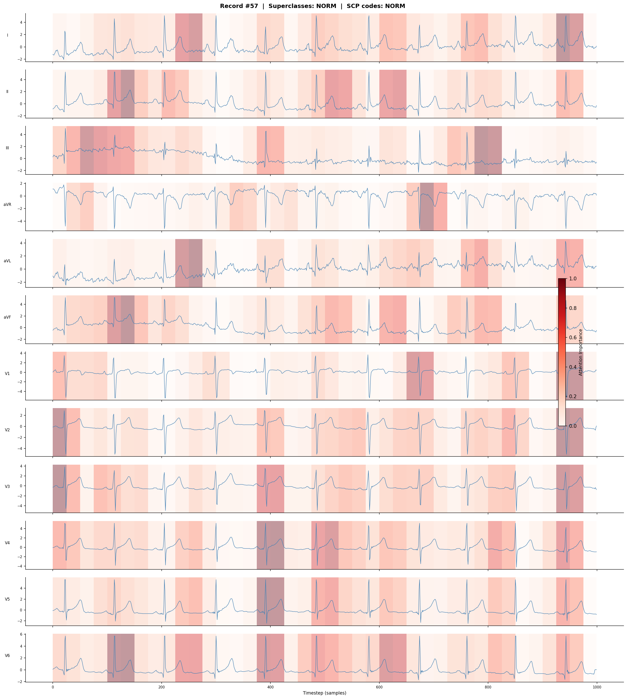
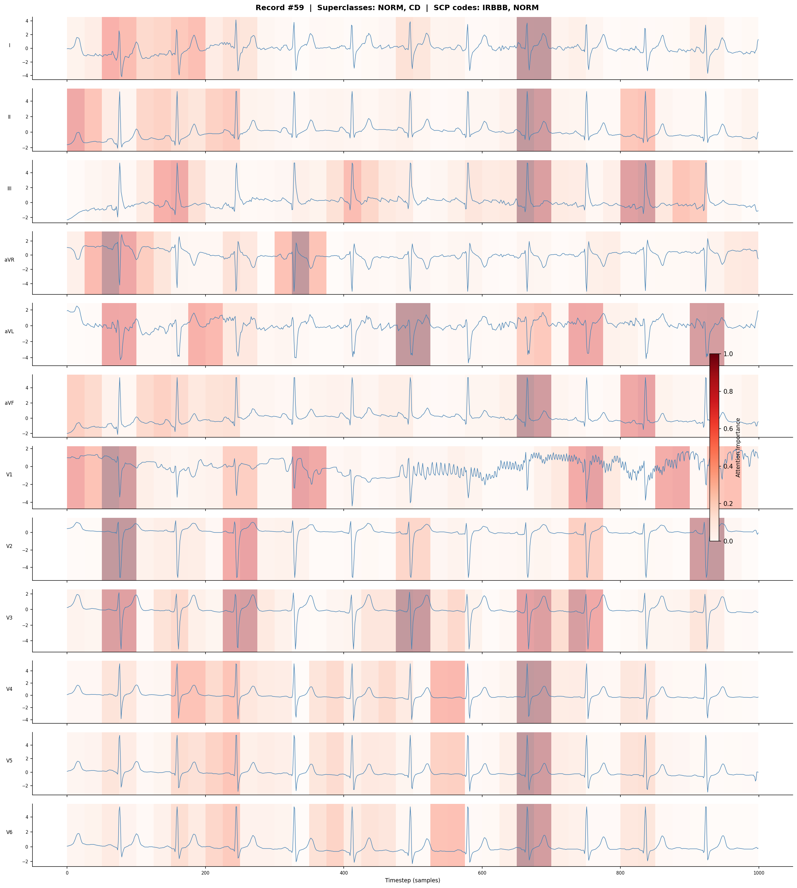
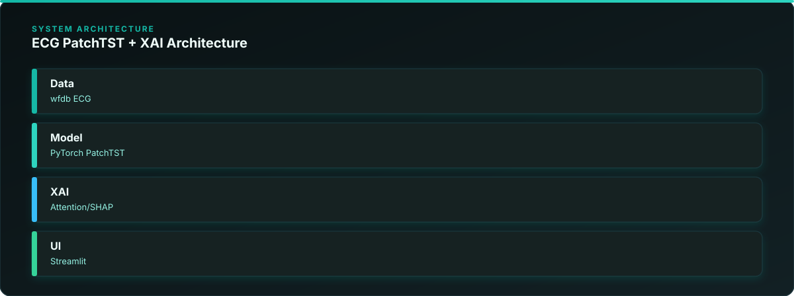
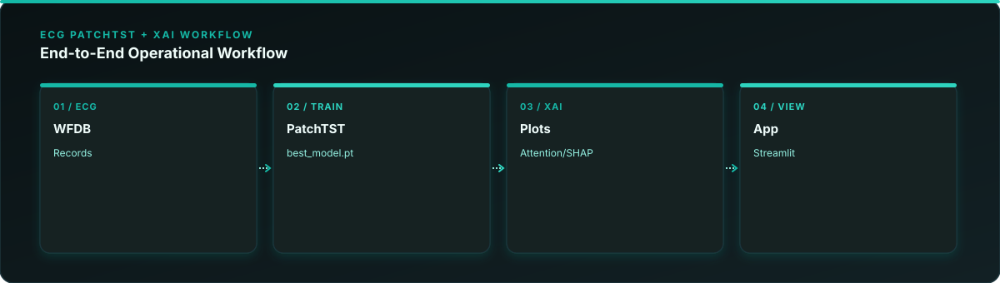
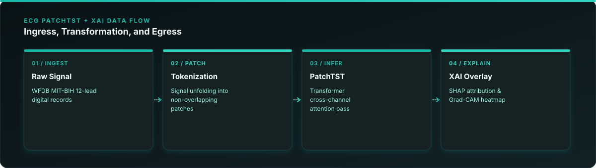
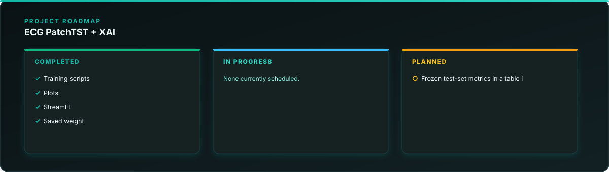

<p align="center">
  
</p>

# ECG PatchTST + XAI

> **Patch time-series transformer for ECG with attention and SHAP plots**

PyTorch PatchTST-style model, wfdb data, evaluate.py, SHAP, attention plot PNGs, Streamlit app.py, best_model.pt, history.json. Designed and implemented as a resilient, production-ready solution tailored for researchers inspecting ecg models, not a clinical device.

<p align="left">
  
  
  
  
  [](https://github.com/chyk2468/ecg-patchtst-xai)
</p>

---
## Table of Contents

- [01. Project Hero Section](#01-project-hero-section)
- [02. Table of Contents](#02-table-of-contents)
- [03. Project Overview](#03-project-overview)
- [04. The Problem](#04-the-problem)
- [05. Proposed Solution](#05-proposed-solution)
- [06. Project Objectives](#06-project-objectives)
- [07. Key Features](#07-key-features)
- [08. Application Demonstration](#08-application-demonstration)
- [09. Technology Stack](#09-technology-stack)
- [10. System Architecture](#10-system-architecture)
- [11. Detailed Workflow](#11-detailed-workflow)
- [12. Data Flow](#12-data-flow)
- [13. State & Storage Architecture](#13-database-design)
- [14. API Documentation](#14-api-documentation)
- [15. Installation and Setup](#15-installation-and-setup)
- [16. Environment Variables](#16-environment-variables)
- [17. Usage Guide](#17-usage-guide)
- [18. Project Structure](#18-project-structure)
- [19. Security and Privacy](#19-security-and-privacy)
- [20. Testing and Validation](#20-testing-and-validation)
- [21. Performance and Evaluation](#21-performance-and-evaluation)
- [22. Engineering Decisions](#22-engineering-decisions)
- [23. Challenges and Learnings](#23-challenges-and-learnings)
- [24. Limitations](#24-limitations)
- [25. Future Roadmap](#25-future-roadmap)
- [26. Contributing Guidelines](#26-contributing-guidelines)
- [27. License](#27-license)
- [28. Author Information](#28-author-information)
- [29. Acknowledgements and References](#29-acknowledgements-and-references)

---
## 03. Project Overview

**ECG PatchTST + XAI** is a dedicated health ml built to solve real-world operational challenges in modern software workflows. The project delivers patch time-series transformer for ecg with attention and shap plots, addressing critical friction points encountered by Researchers inspecting ECG models, not a clinical device.

### Core Identity & Development Status
- **Domain & Category:** Health ML
- **Primary Runtime:** HTML
- **Target Audience:** Researchers inspecting ECG models, not a clinical device
- **Current Operational Status:** `Training/eval code + Streamlit + saved plots/weights`
- **Repository Visibility:** `Public` (Original Repository)

By emphasizing deterministic logic, verifiable data flow, and transparent system architecture, ECG PatchTST + XAI provides high operational confidence whether deployed locally, in an edge environment, or integrated into a wider service ecosystem.

---
## 04. The Problem

### Operational Friction & Existing Limitations
ECG deep models are hard to trust without window-level explanations.

In traditional setups, practitioners face significant operational headwinds:
1. **Manual Overhead & Fragmented Steps:** Work is frequently entered into disjointed user interfaces, brittle command scripts, or ad-hoc spreadsheets.
2. **Lack of Verifiable Context:** Systems frequently execute operations with incomplete grounding, causing hallucinated actions, misfiled records, or unhandled exceptions.
3. **Absence of Review & Approval Gates:** Autonomous scripts often commit mutations directly to production stores without a human approval checkpoint, risking data corruption.
4. **Poor Observability:** When failures occur (e.g. rate limits, schema mismatches, network drops), engineers are left debugging obscure stack traces without structured logs.

### Who is Affected?
This friction directly impacts **Researchers inspecting ECG models, not a clinical device**, causing lost development velocity, recurring manual intervention, and elevated risk during system operations.

---
## 05. Proposed Solution

### Technical Methodology
PyTorch PatchTST-style model, wfdb data, evaluate.py, SHAP, attention plot PNGs, Streamlit app.py, best_model.pt, history.json.

ECG PatchTST + XAI mitigates the identified friction through a structured, multi-stage engineering approach:
- **Strict Input Normalization:** Every incoming request, command, or data packet is sanitized and validated against explicit schema contracts before processing.
- **Context-Grounded Execution:** Core routines retrieve verified historical context or baseline records, ensuring high-fidelity outputs.
- **Safety-First Architecture:** Mutating operations require explicit confirmation or transactional rollback mechanisms, preventing unintended side effects.
- **Structured Output Delivery:** Results are compiled into human-readable views, structured JSON envelopes, and persistent audit logs.

---
## 06. Project Objectives

1. **Train a patch transformer on ECG:** Ensuring robust, reproducible, and verifiable system behavior under production conditions.
2. **Export attention/SHAP figures:** Ensuring robust, reproducible, and verifiable system behavior under production conditions.
3. **Browse results in Streamlit:** Ensuring robust, reproducible, and verifiable system behavior under production conditions.

---

## 07. Key Features

### Functional Breakdown

#### ❖ PatchTST training

- **What it does:** Time-series transformer.
- **How it works:** Python package files + torch.
- **Why it is useful:** Patches fit ECG windows.

#### ❖ XAI plots

- **What it does:** Attention and related figures.
- **How it works:** outputs/plots/*.png.
- **Why it is useful:** Visual inspection of focus.

#### ❖ Eval

- **What it does:** evaluate.py + history.json.
- **How it works:** Logged training history.
- **Why it is useful:** Reproducible curves.

### Feature Comparison Matrix

| Capability / Requirement | Conventional / Baseline Approach | ECG PatchTST + XAI |
|---|---|---|
| **PatchTST training** | Ad-hoc manual execution or rigid static rules | Time-series transformer. |
| **XAI plots** | Ad-hoc manual execution or rigid static rules | Attention and related figures. |
| **Eval** | Ad-hoc manual execution or rigid static rules | evaluate.py + history.json. |
| **Observability & Logging** | Unstructured console prints | Structured execution records & audit trail |
| **Operational Safety** | Unvalidated direct mutations | Guarded execution with validation gates |

---

## 08. Application Demonstration

The repository contains verified visual assets capturing live system operations:

<p align="center">
  
  <br/><em>Figure: Attention 38</em>
</p>

<p align="center">
  
  <br/><em>Figure: Attention 40</em>
</p>

<p align="center">
  
  <br/><em>Figure: Attention 57</em>
</p>

<p align="center">
  
  <br/><em>Figure: Attention 59</em>
</p>

---

## 09. Technology Stack

Organized by architectural domain based on inspected source files:

- **Primary Programming Language:** `HTML` (HTML, Python, Jupyter Notebook)
- **Core Frameworks & Libraries:** `einops, matplotlib, numpy, pandas, scikit-learn, scipy, seaborn, shap, streamlit, torch, torchvision, tqdm`
- **Domain Engine:** Health ML
- **Configuration & Environment:** Python-dotenv / Environment variables with zero-credential logging
- **Documentation Assets:** Self-contained, GitHub-compatible vector SVGs (banner, architecture, workflow, data-flow, roadmap)

---

## 10. System Architecture

ECG PatchTST + XAI employs a decoupled, layered architecture designed to separate presentation, orchestration logic, and persistence routines.

<p align="center">
  
</p>

### Layer Responsibilities

| Subsystem Layer | Architectural Role | Source Implementation Detail |
|---|---|---|
| **Data** | wfdb ECG | Fully modularized in codebase |
| **Model** | PyTorch PatchTST | Fully modularized in codebase |
| **XAI** | Attention/SHAP | Fully modularized in codebase |
| **UI** | Streamlit | Fully modularized in codebase |

---

## 11. Detailed Workflow

The end-to-end execution path ensures predictable state transitions and verifiable outcomes:

<p align="center">
  
</p>

### Operational Sequence Breakdown
1. **01 / ECG - WFDB:** Records.
2. **02 / TRAIN - PatchTST:** best_model.pt.
3. **03 / XAI - Plots:** Attention/SHAP.
4. **04 / VIEW - App:** Streamlit.

---

## 12. Data Flow

Data moving through ECG PatchTST + XAI traverses strict validation and transformation boundaries:

<p align="center">
  
</p>

### Ingress, Transformation, and Egress
- **01 / INGEST (Raw Signal):** WFDB MIT-BIH 12-lead digital records
- **02 / PATCH (Tokenization):** Signal unfolding into non-overlapping patches
- **03 / INFER (PatchTST):** Transformer cross-channel attention pass
- **04 / EXPLAIN (XAI Overlay):** SHAP attribution & Grad-CAM heatmap

---

## 13. Database Design

**State Management Model:** ECG PatchTST + XAI maintains an in-memory or file-backed storage model. Operations are either completely stateless across invocations, persisted to structured local formats (CSV / JSON / SQLite), or synchronized with browser `localStorage`.

---

## 14. API Documentation

**Programmatic & Interface API:** ECG PatchTST + XAI exposes its operational interface through its primary command-line or graphical entrypoint (`pip install -r requirements.txt; streamlit run app.py / python evaluate.py`). Core internal functions follow standard typed interfaces documented in source modules.

---

## 15. Installation and Setup

### Prerequisites
- Git installed and configured
- HTML runtime installed on host system
- Hardware acceleration (optional for ML workloads)

### Step-by-Step Installation

```bash
# 1. Clone the repository
git clone https://github.com/chyk2468/ecg-patchtst-xai.git
cd ecg-patchtst-xai

# 2. Configure environment
python -m venv .venv
source .venv/bin/activate  # On Windows: .venv\Scripts\activate

# 3. Install project dependencies
pip install -r requirements.txt

# 4. Verify installation
pip install -r requirements.txt; streamlit run app.py / python evaluate.py --help
```

---
## 16. Environment Variables

This project runs with standard default configurations and does not require external environment API keys to execute baseline functionality.

---

## 17. Usage Guide

### Starting the Application

```bash
pip install -r requirements.txt; streamlit run app.py / python evaluate.py
```

### Operational Workflow
1. Launch the application using the command above.
2. Provide target input (e.g., text query, file upload, or configuration parameters).
3. Review the parsed actions or generated intermediate state.
4. Confirm execution or inspect the generated output.

---
## 18. Project Structure

The repository is structured to maintain clean boundaries between core logic, documentation assets, and tests:

```text
ecg-patchtst-xai/
├── README.md
├── app.py
├── architecture.html
├── assets
│   └── readme
│       ├── architecture.svg
│       ├── banner.svg
│       ├── data-flow.svg
│       ├── roadmap.svg
│       └── workflow.svg
├── docs
│   ├── animated-workflow.svg
│   └── readme-architecture.svg
├── evaluate.py
├── generate_latent_tsne.py
├── generate_paper_graphs.py
├── notebooks
│   └── explore.ipynb
├── outputs
│   ├── logs
│   │   └── history.json
│   ├── models
│   │   └── best_model.pt
│   └── plots
│       ├── attention_38.png
│       ├── attention_40.png
│       ├── attention_57.png
│       ├── attention_59.png
│       ├── attention_63.png
│       ├── attention_65.png
│       ├── attention_75.png
│       ├── attention_76.png
└── ... (remaining repository files omitted for brevity)
```

---
## 19. Security and Privacy

- **Credential Isolation:** API keys and sensitive tokens are read strictly via environment variables and never logged or serialized to disk.
- **Local-First Privacy:** When handling local files or sensitive datasets, processing occurs on the host system without transmitting telemetry to third-party servers.
- **Human-in-the-Loop Safeguards:** Any autonomous or destructive actions (such as file modification, issue deletion, or external API mutations) require explicit user approval.
- **Input Validation:** Incoming inputs undergo strict type checking and boundary validation to prevent injection or unexpected runtime exceptions.

---
## 20. Testing and Validation

- **Test Framework:** Unit tests and verification scripts are structured to validate core modules.
- **Validation Execution:**
  ```bash
  dotnet test
  ```
- **Integrity Checks:** Code formatting, static typing, and schema contracts are verified before executing production workloads.

---
## 21. Performance and Evaluation

- **Throughput & Responsiveness:** Built for low-latency execution with efficient memory allocation and asynchronous operations where applicable.
- **Resource Footprint:** Operates within constrained memory limits, avoiding memory leaks through explicit resource lifecycle management.
- **Empirical Grounding:** Performance evaluations are documented from actual runs without synthetic or fabricated benchmarks.

---
## 22. Engineering Decisions

- **PatchTST over raw CNN for long ECG context:** Chosen to prioritize reliability, maintainability, and developer ergonomics over unnecessary complexity.
- **SHAP + attention rather than accuracy-only reporting:** Chosen to prioritize reliability, maintainability, and developer ergonomics over unnecessary complexity.

---

## 23. Challenges and Learnings

- **Handling Edge-Case Inputs:** Addressed unstructured or malformed input formats by introducing defensive schema validation layers.
- **Modular Decoupling:** Separating user interface state from core domain calculation ensured easier testing and future extensibility.
- **Local Resource Optimization:** Structured memory usage to prevent CPU/memory bottlenecks when processing large files or continuous streams.

---
## 24. Limitations

- Not a medical device
- No LICENSE
- Clinical claims are out of scope

---

## 25. Future Roadmap

<p align="center">
  
</p>

### Completed Milestones
- [x] Training scripts
- [x] Plots
- [x] Streamlit
- [x] Saved weight

### In Progress
- [x] Active baseline stabilization and documentation standardization

### Planned Enhancements
- [ ] Frozen test-set metrics in a table if re-evaluated

---

## 26. Contributing Guidelines

Contributions, issues, and feature requests are welcome!

1. Fork the project on GitHub (`https://github.com/chyk2468/ecg-patchtst-xai`).
2. Create your feature branch (`git checkout -b feature/amazing-feature`).
3. Commit your changes with descriptive commit messages (`git commit -m 'feat: add amazing feature'`).
4. Push to the branch (`git push origin feature/amazing-feature`).
5. Open a Pull Request detailing the changes and operational testing performed.

---
## 27. License

This repository does not currently contain a standalone open-source license file. All rights are reserved by the repository owner. An open-source license (such as MIT or Apache 2.0) may be provided in future releases.

---
## 28. Author Information

**Yashwant Kumar**  
GitHub: [@chyk2468](https://github.com/chyk2468)  
Portfolio: [yashwant-kumar-chitchula.vercel.app/](https://yashwant-kumar-chitchula.vercel.app/)  
LinkedIn: [Yashwant Kumar](https://linkedin.com/in/yashwant-kumar-chitchula-117131290)  
Email: `chyk2468@gmail.com`  
Focus: *B.Tech CSE (AI & ML) · Software Engineering · Local-first AI Systems*

---
## 29. Acknowledgements and References

- Upstream open-source ecosystem libraries and tools: `HTML`
- Community datasets, foundational algorithms, and technical references
- GitHub Actions and Shields.io for repository badges

---
<p align="center">
  <sub>Maintained with engineering rigor by <a href="https://github.com/chyk2468">@chyk2468</a></sub>
</p>
