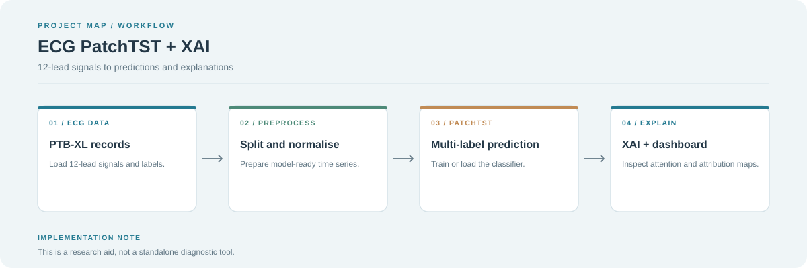

# 🫀 ECG PatchTST + XAI

[](https://www.python.org/)
[](https://pytorch.org/)
[](https://streamlit.io/)
[](https://opensource.org/licenses/MIT)

**ECG PatchTST + XAI** is a deep learning framework for multi-label ECG classification using the **PatchTST** (Patch Time Series Transformer) architecture. It focuses on high performance and deep interpretability for cardiac arrhythmia detection using the **PTB-XL** dataset.

---



## 🚀 Key Features

- **PatchTST Backbone**: Leverages patch-based transformer encoders for efficient and long-range dependency modeling in 12-lead ECG signals.
- **Multi-Label Classification**: Predicts 71 SCP codes and 7 diagnostic superclasses (NORM, MI, STTC, CD, HYP, FORM, RHYTHM).
- **Comprehensive XAI Suite**: Includes Attention Maps, Grad-CAM, Integrated Gradients, Occlusion Sensitivity, and SHAP.
- **Interactive Dashboard**: A sleek Streamlit app for real-time ECG analysis and visualization.
- **Data Pipeline**: Automated preprocessing, Z-score normalization, and PTB-XL recommended train/val/test splits.

---

## 🧠 XAI Suite: Explainable AI

Understanding *why* a model makes a prediction is critical in healthcare. This project implements several interpretability techniques:

| Method | Description | Output |
| :--- | :--- | :--- |
| **Attention Maps** | Visualizes which patches/timesteps the transformer focused on. | Heatmap over signal |
| **Lead Importance** | Quantifies the contribution of each of the 12 leads. | Bar Chart |
| **Grad-CAM** | Class Activation Mapping via gradients to highlight salient regions. | Gradient Heatmap |
| **SHAP** | Game-theoretic approach to explain individual predictions. | Radial Importance Plot |
| **Integrated Grads** | Attributes predictions to input features using path integrals. | Attribution Map |
| **Occlusion** | Measures sensitivity by systematically masking parts of the signal. | Sensitivity Map |

---

## 📂 Project Structure

```text
ecg-patchtst-xai/
├── app.py                  # Interactive Streamlit dashboard
├── train.py                # Model training entry point
├── evaluate.py             # Performance evaluation & XAI generation
├── generate_latent_tsne.py # t-SNE visualization of model embeddings
├── generate_paper_graphs.py # Publication-quality result plotting
├── src/
│   ├── data/               # PTB-XL loaders and preprocessing
│   ├── models/             # PatchTST & Classification Heads
│   ├── training/           # Trainer class and metric logic
│   ├── xai/                # Implementation of all interpretability tools
│   └── utils/              # Configuration and label mapping
├── outputs/
│   ├── models/             # Saved weights (.pt)
│   ├── plots/              # Generated XAI visualizations
│   └── logs/               # Training history (JSON)
└── data/                   # (Optional) Local symlink to PTB-XL
```

---

## 🛠️ Installation & Setup

1. **Clone the repository:**
   ```bash
   git clone https://github.com/your-username/ecg-patchtst-xai.git
   cd ecg-patchtst-xai
   ```

2. **Install dependencies:**
   ```bash
   pip install -r requirements.txt
   ```

3. **Configure Dataset Path:**
   Edit `src/utils/config.py` and update the `DATA_ROOT` variable to point to your PTB-XL dataset directory.

---

## 🏃 Usage

### 1. Training
Train the model on the PTB-XL dataset (folds 1-8 for training, 9 for validation):
```bash
python train.py
```

### 2. Evaluation & XAI Generation
Evaluate the best model on the test set (fold 10) and generate attention/Grad-CAM plots for samples:
```bash
python evaluate.py
```

### 3. Latent Space Analysis
Visualize the model's learned representation using t-SNE:
```bash
python generate_latent_tsne.py
```

### 4. Launch Interactive App
Run the Streamlit dashboard to analyze custom ECG records or specific PTB-XL files:
```bash
streamlit run app.py
```

---

## 📊 Visualizations

The project generates rich visual feedback, saved in `outputs/plots/`:
- **Attention Heatmaps**: Overlays on the 12-lead signal.
- **Lead Importance**: Relative weighting of different leads (e.g., V1 vs II).
- **3D Cluster Plot**: Interactive HTML visualization of the latent space (`superclass_3d_clustering.html`).
- **Confusion Matrices & ROC Curves**: Standard performance metrics.

---

## 📚 Dataset Reference

This project uses the **PTB-XL** dataset:
> Wagner, P., Strodthoff, N., Bousseljot, R., Samek, W., & Schaeffter, T. (2020). PTB-XL, a large publicly available electrocardiography dataset (version 1.0.1). PhysioNet. [https://doi.org/10.13026/x4td-ks67](https://doi.org/10.13026/x4td-ks67)

---

## 📄 License
Distributed under the MIT License. See `LICENSE` for more information.
