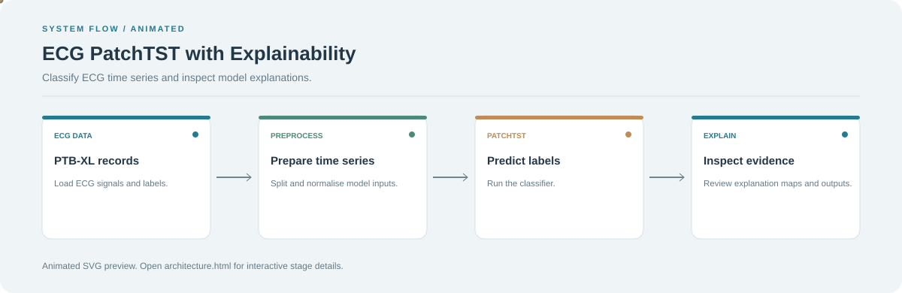

# ECG PatchTST with Explainability

**Classify ECG time series and inspect model explanations.**

[](https://github.com/chyk2468/ecg-patchtst-xai)

## 1. Project Title & Tagline

Classify ECG time series and inspect model explanations.

## 2. Problem Statement

ECG classification needs careful evaluation, and predictions are difficult to interpret without supporting evidence. This research project combines a PatchTST model with explainability outputs for inspection.

## 3. Project Preview

Add a screenshot or short GIF showing a representative input, prediction, and explanation or visual output.

[Open interactive architecture](architecture.html)

## 4. Overview

The pipeline prepares input data, applies the configured model or processing logic, and presents outputs for review. The workflow diagram summarises the main stages.

## 5. Key Features

- Prepare multi-lead ECG signals.
- Train or load a PatchTST classifier.
- Evaluate model predictions.
- Inspect explanation or attribution visualisations.

## 6. Architecture / Workflow



Open the [interactive architecture explorer](architecture.html) to select a stage and inspect its role.

## 7. Tech Stack

Python, PyTorch, PatchTST, ECG datasets and explainability libraries configured by the project

## 8. Installation & Setup

```bash
git clone https://github.com/chyk2468/ecg-patchtst-xai.git
cd ecg-patchtst-xai
```

Install the project's dependencies and configure the ECG dataset paths before running the notebook or app.

## 9. Usage

Follow the repository's dataset preparation and training/evaluation instructions. Inspect predictions and explanation maps, and avoid treating model outputs as clinical diagnoses.

## 10. Project Structure

Inspect the dataset/preprocessing code, PatchTST model, evaluation scripts, explainability utilities, and Streamlit interface.

## 11. Results & Demo

Add the test split, label definitions, per-class metrics, and representative explanation plots. Report uncertainty and dataset limitations.

## 12. Future Enhancements

- Evaluate across patient-level splits.
- Add calibration and confidence analysis.
- Compare explainability methods with domain review.
- Document reproducibility settings and model checkpoints.

## 13. License

Check the code, ECG dataset, and pretrained model licences. This is a research tool, not a standalone diagnostic device.
